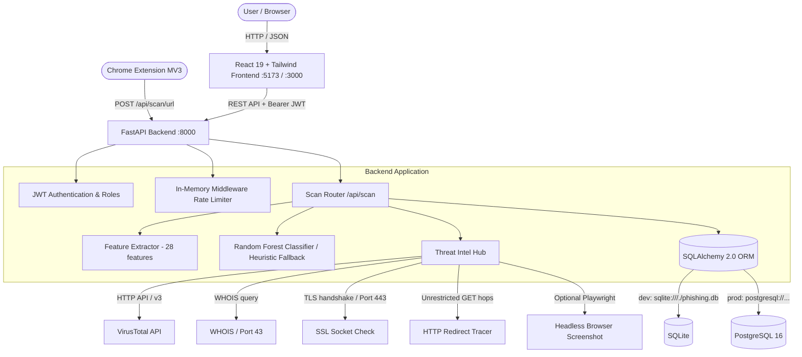

# Current System Architecture: Phishing Link Detection Platform

## 1. System Overview

The platform is a multi-tier cybersecurity application designed for real-time phishing URL detection, threat intelligence correlation, and QR code inspection.

---

## 2. Component Breakdown

### 2.1 Frontend
- **Framework**: React 19.2.6, Vite 8.0.12 (rolldown), React Router DOM 7.18.0.
- **Styling**: Tailwind CSS 3.4.19, Lucide React icons.
- **Data Visualization**: Recharts 3.8.1.
- **HTTP Client**: Axios with `localStorage` JWT Bearer token interceptor and 401 redirect to `/login`.
- **Pages**:
  - `Landing.jsx`: Public landing page with product overview and call-to-actions.
  - `Scanner.jsx`: Single URL analysis and QR code file drop upload.
  - `BulkScanner.jsx`: Batch scanning up to 50 URLs at a time.
  - `Dashboard.jsx`: Scan history, metrics, risk distribution charts, and CSV/JSON export.
  - `EmailAnalyzer.jsx`: Raw email header parser extracting and scanning embedded URLs.
  - `ThreatFeed.jsx`: Public real-time feed of detected suspicious/phishing URLs.
  - `Leaderboard.jsx`: Community scanner rankings by volume and phishing caught.
  - `Settings.jsx`: API key management, whitelist management, email alert thresholds, dark/light theme toggle.
  - `AdminPanel.jsx`: User management (role toggling, active deactivation), global metrics, banned domain registry.
  - `Login.jsx` & `Register.jsx`: JWT authentication workflows.

### 2.2 Backend API
- **Framework**: FastAPI 0.111.0 running on Uvicorn ASGI.
- **Database & Persistence**: SQLAlchemy 2.0.30 ORM with SQLite for local development (`phishing.db`) and PostgreSQL for Docker/production. Automatic table creation via `Base.metadata.create_all(bind=engine)`.
- **Security & Middleware**:
  - `CORSMiddleware`: Currently hardcoded to `http://localhost:3000` and `http://localhost:5173`.
  - In-memory sliding window rate limiter: 30 requests per 60 seconds per client IP on `/api/scan/*`.
- **API Routers**:
  - `/api/auth`: User registration, OAuth2 password form login (JWT access token generation), `/me` profile.
  - `/api/scan`: `/url`, `/bulk`, `/qr`, `/history`, `/history/export`, `/stats`, `/feed`, `/leaderboard`, `/email-headers`.
  - `/api/apikeys`: User self-service API key generation (`pg_<token_urlsafe(32)>`, SHA-256 hashed).
  - `/api/whitelist`: User-defined domain whitelist short-circuiting phishing verdicts.
  - `/api/alerts`: Per-user email alert preferences (min risk threshold) sent via SMTP.
  - `/api/admin`: Administrative user role assignment, user activation, system stats, and global domain blacklists (`banned_domains`).
  - `/api/users`: Profile updates (theme preference, email address changes).

### 2.3 Machine Learning Pipeline
- **Algorithm**: Scikit-learn `RandomForestClassifier` (200 trees, `max_depth=20`, `n_jobs=-1`, `random_state=42`).
- **Input Features**: Exactly 28 numerical features extracted per URL:
  1. `url_length`
  2. `domain_length`
  3. `path_length`
  4. `num_dots`
  5. `num_hyphens`
  6. `num_underscores`
  7. `num_slashes`
  8. `num_question_marks`
  9. `num_equals`
  10. `num_ampersands`
  11. `num_at`
  12. `num_exclamation`
  13. `num_percent`
  14. `num_digits_in_url`
  15. `has_ip_address`
  16. `has_at_symbol`
  17. `has_double_slash_redirect`
  18. `uses_https`
  19. `num_subdomains`
  20. `has_hyphen_in_domain`
  21. `domain_has_digits`
  22. `has_suspicious_keywords`
  23. `subdomain_suspicious`
  24. `has_suspicious_tld`
  25. `has_hex_encoding`
  26. `has_punycode`
  27. `has_non_standard_port`
  28. `url_depth`
- **Output Classes**: `0: legitimate`, `1: suspicious`, `2: phishing`.
- **Risk Score Formulation**: `float(proba[1] * 0.5 + proba[2]) * 100` (rounded to 1 decimal place).
- **Fallback**: Static rule-based heuristic scoring (0 to 100) if `model.pkl` is missing.

### 2.4 Threat Intelligence & Enrichment
- **VirusTotal**: Submits URL to `https://www.virustotal.com/api/v3/urls` and polls analysis result attributes via `x-apikey`.
- **WHOIS**: Queries registration metadata using `python-whois`, calculating `domain_age_days` and flagging `is_new_domain` (<180 days).
- **SSL**: Native socket connect on port 443 with default SSL context to extract certificate subject, issuer, validity period, and expiration.
- **Typosquatting**: Levenshtein-like distance check (`difflib.SequenceMatcher`) against top 25 global brands (Google, Microsoft, Amazon, PayPal, etc.) with >= 75% similarity threshold.
- **Redirect Tracing**: Follows HTTP redirect chains up to 10 hops using `httpx.AsyncClient`.
- **QR Code Decoding**: Reads uploaded image buffer via `PIL.Image` and decodes payloads via `pyzbar.pyzbar.decode`.
- **Screenshotting**: Headless Chromium via Playwright (optional query parameter `screenshot=true`).

### 2.5 Chrome Browser Extension (Manifest V3)
- **Manifest Version**: 3
- **Permissions**: `activeTab`, `tabs`, `storage`, `notifications`, `host_permissions: ["<all_urls>"]`.
- **Architecture**:
  - `background.js`: Service worker listening to `chrome.tabs.onUpdated`. Scans navigated URLs via `http://localhost:8000/api/scan/url`. Updates action badge and dispatches warning notifications.
  - `content.js`: Injected into web pages to display a full-page modal blocking overlay (`#phishguard-overlay`) on high-risk detections.
  - `popup.html` / `popup.js`: On-demand scan UI displaying risk score gauge, verdict, and recommendations.

---

## 3. Deployment & Containerization (Current State)
- **Local Development**: Python `uvicorn` on port 8000; Vite dev server on port 5173.
- **Docker Compose**:
  - Service `db`: `postgres:16-alpine` on port 5432.
  - Service `backend`: Python 3.11-slim container building FastAPI app on port 8000.
  - Service `frontend`: Node build container served via Nginx on port 3000.
